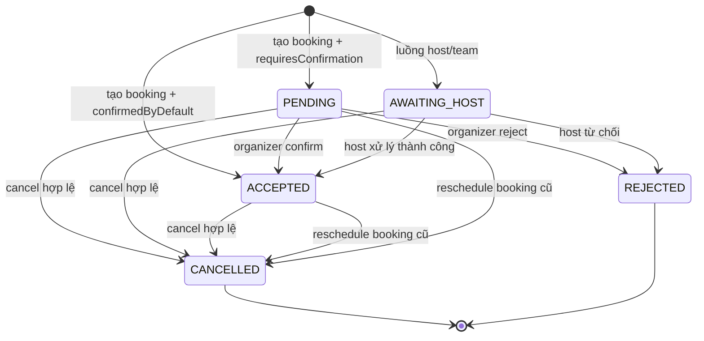

# Issue 05 - Mô hình trạng thái booking cho Model-Based Testing

Tài liệu này mô tả mô hình trạng thái dùng để thiết kế kiểm thử dựa trên mô hình (MBT) cho booking. Mô hình được đối chiếu với mã nguồn trên nhánh `qa/model-based-booking` và với bằng chứng chạy thử đã có trong [Issue 04](issue-04-booking-business-data.md). Các kết luận được gắn nhãn **[Code]**, **[Test]**, **[Observed]** hoặc **[Assumption]** để không nhầm suy luận với quan sát thực tế.

## 1. Phạm vi và quy ước

Phạm vi là một booking cá nhân không recurring, không seat, không thanh toán và không tích hợp calendar ngoài. Booker, host và event type dùng dữ liệu giả; thời gian được lưu/đối chiếu bằng UTC và hiển thị thêm `Asia/Saigon`. Mô hình không đại diện cho từng bản ghi database trung gian trong transaction và không suy ra trạng thái từ nhãn UI.

Các trạng thái lấy từ `BookingStatus` trong [`packages/prisma/schema.prisma`](../../packages/prisma/schema.prisma):

| Ký hiệu | `BookingStatus` | Ý nghĩa trong mô hình |
| --- | --- | --- |
| `PENDING` | `PENDING` | Booking cần organizer xác nhận. **[Code]** |
| `ACCEPTED` | `ACCEPTED` | Booking đã được xác nhận hoặc event type xác nhận mặc định. **[Code]** |
| `AWAITING_HOST` | `AWAITING_HOST` | Booking đang chờ host xử lý trong các luồng host/team. Có enum và logic liên quan, nhưng chưa chạy trong phạm vi này. **[Code][Assumption]** |
| `REJECTED` | `REJECTED` | Organizer từ chối booking chờ xác nhận. **[Test]** |
| `CANCELLED` | `CANCELLED` | Booking bị hủy, hoặc bản ghi cũ bị đóng khi đổi lịch. **[Test][Observed]** |

`CANCELLED` và `REJECTED` là trạng thái kết thúc của booking cụ thể trong phạm vi này. Một booking đã đổi lịch không bị xóa: booking cũ chuyển sang `CANCELLED`, còn booking mới có UID riêng và liên kết `fromReschedule` trỏ về UID cũ. **[Code][Observed]**

## 2. Sơ đồ trạng thái

Mũi tên tạo booking và các chuyển tiếp confirm/reject được xác định từ `createBooking.ts`, `confirm.handler.ts` và bài test `booking-confirm-reject.e2e.ts`. Mũi tên `AWAITING_HOST` là phần cần giữ trong mô hình enum; chưa có quan sát chạy thử cho chuỗi này. Việc hủy `PENDING`/`AWAITING_HOST` được giữ như chuyển tiếp cần kiểm chứng thêm nếu không có fixture tương ứng. **[Code][Assumption]**

## 3. Bảng chuyển tiếp và oracle

| ID | Trạng thái trước | Sự kiện và điều kiện | Trạng thái sau | Oracle quan sát được | Nguồn |
| --- | --- | --- | --- | --- | --- |
| T01 | không có booking | Gửi form với event type xác nhận mặc định | `ACCEPTED` | Có đúng một booking; `status=ACCEPTED`; thời gian UTC khớp slot | [Issue 04 E2E](../../apps/web/playwright/issue-04-booking-lifecycle.e2e.ts), [evidence](evidence/issue-04-booking-lifecycle.json) **[Test][Observed]** |
| T02 | không có booking | Gửi form với `requiresConfirmation=true` | `PENDING` | Booking được tạo với `status=PENDING`, còn token xác nhận | [booking-confirm-reject.e2e.ts](../../apps/web/playwright/booking-confirm-reject.e2e.ts) **[Test]** |
| T03 | `PENDING` | Organizer confirm bằng token hợp lệ | `ACCEPTED` | HTTP redirect thành công; `status=ACCEPTED`; `oneTimePassword=null` | [booking-confirm-reject.e2e.ts](../../apps/web/playwright/booking-confirm-reject.e2e.ts) **[Test]** |
| T04 | `PENDING` | Organizer reject bằng token hợp lệ và lý do | `REJECTED` | HTTP redirect thành công; `status=REJECTED`; `rejectionReason` khớp; token bị xóa | [booking-confirm-reject.e2e.ts](../../apps/web/playwright/booking-confirm-reject.e2e.ts) **[Test]** |
| T05 | `ACCEPTED` hoặc `PENDING` | Reschedule hợp lệ tới slot mới | Bản ghi cũ `CANCELLED`; bản ghi mới `ACCEPTED` hoặc `PENDING` tùy cấu hình | UID mới khác UID cũ; cũ có `rescheduled=true`; mới có `fromReschedule=UID cũ`; thời gian mới khác | [`createBooking.ts`](../../packages/features/bookings/lib/handleNewBooking/createBooking.ts), [Issue 04 E2E](../../apps/web/playwright/issue-04-booking-lifecycle.e2e.ts) **[Code][Observed]** |
| T06 | `ACCEPTED` | Cancel hợp lệ trước khi booking kết thúc | `CANCELLED` | `cancellationReason` và `cancelledBy` được lưu; không đổi UID | [Issue 04 E2E](../../apps/web/playwright/issue-04-booking-lifecycle.e2e.ts), [`handleCancelBooking.ts`](../../packages/features/bookings/lib/handleCancelBooking.ts) **[Test][Observed]** |
| T07 | `CANCELLED` với `rescheduled=false` | Dùng lại link reschedule | Không tạo booking mới | Request bị từ chối với lỗi booking đã hủy không thể đổi lịch | [`originalRescheduledBookingUtils.ts`](../../packages/features/bookings/lib/handleNewBooking/originalRescheduledBookingUtils.ts) **[Code]** |
| T08 | bất kỳ trạng thái | Slot mới không khả dụng, thiếu quyền, quá hạn hoặc vi phạm minimum notice | Không đổi trạng thái thành công | Request lỗi; phải kiểm tra status và không chấp nhận oracle “đã đổi lịch” | [`RegularBookingService.ts`](../../packages/features/bookings/lib/service/RegularBookingService.ts), [`determineReschedulePreventionRedirect.ts`](../../packages/features/bookings/lib/reschedule/determineReschedulePreventionRedirect.ts) **[Code]** |

Trong T05, `fromReschedule` là liên kết logic giữa hai booking, không phải UID được tái sử dụng. Bằng chứng Issue 01 cho thấy UID A và UID B khác nhau, B lưu `fromReschedule=UID A`; tài liệu Issue 01 cũng ghi rõ trạng thái database ngay sau từng bước của phiên cũ chưa được chụp riêng. Vì vậy chỉ dùng bằng chứng Issue 04 để đánh dấu chuyển tiếp T05 là đã quan sát. **[Observed]**

## 4. Tiêu chí coverage

Một phiên MBT đạt khi thỏa cả bốn nhóm sau:

1. **State coverage:** đã xuất hiện `PENDING`, `ACCEPTED`, `REJECTED` và `CANCELLED`; `AWAITING_HOST` phải được đánh dấu chưa kiểm chứng nếu không có fixture host/team.
2. **Transition coverage:** chạy ít nhất một lần T01, T03, T04, T05 và T06; T07/T08 phải có ca lỗi riêng hoặc được ghi rõ là chưa chạy.
3. **Guard coverage:** có một ca event type xác nhận mặc định, một ca yêu cầu xác nhận, một ca token hợp lệ và một ca slot/điều kiện reschedule không hợp lệ.
4. **Data-oracle coverage:** sau mỗi bước đọc chỉ các trường `uid`, `status`, `rescheduled`, `fromReschedule`, `startTime`, `endTime`, `cancellationReason`, `rejectionReason`, `oneTimePassword` và các cờ actor cần thiết; không ghi email, token, credential hoặc URL quản lý.

## 5. Ba chuỗi kiểm thử tối thiểu

Các chuỗi dưới đây là kế hoạch kiểm thử và oracle. Chuỗi S01 đã có kết quả chạy trong Issue 04; S02 và S03 có test tự động kiểm tra chuyển tiếp nhưng chưa phải một phiên chạy mới của tài liệu này.

| Chuỗi | Các bước | Nhánh được phủ | Oracle cuối chuỗi |
| --- | --- | --- | --- |
| S01 - happy path và reschedule | T01 tạo A `ACCEPTED` → T05 đổi A sang B → T06 hủy B | tạo mặc định, UID mới, liên kết cũ-mới, hủy | A: `CANCELLED` + `rescheduled=true`; B: UID khác, `fromReschedule=A.uid`; sau hủy B: `CANCELLED` + lý do đúng; không có booking mới ngoài A/B |
| S02 - confirm | T02 tạo C `PENDING` → T03 organizer confirm | yêu cầu xác nhận, chuyển `PENDING → ACCEPTED` | C giữ nguyên UID; `status=ACCEPTED`; `oneTimePassword=null`; không tạo bản ghi thay thế |
| S03 - reject | T02 tạo D `PENDING` → T04 organizer reject với lý do | yêu cầu xác nhận, chuyển `PENDING → REJECTED` | D giữ nguyên UID; `status=REJECTED`; `rejectionReason` khớp; `oneTimePassword=null`; không gọi oracle của `ACCEPTED` |

### Điều kiện pass/fail

- **Pass:** trạng thái và các trường liên kết sau mỗi bước khớp bảng T01-T08; mã HTTP/UI chỉ là tín hiệu phụ, không thay thế truy vấn dữ liệu.
- **Fail:** một trạng thái không thuộc chuyển tiếp, UID mới trùng UID cũ, `fromReschedule` trỏ sai, booking cũ không bị đánh dấu `rescheduled`, hoặc lý do/token không khớp oracle.
- **Chưa kiểm chứng:** không được ghi là pass khi chỉ nhìn UI, khi chỉ đọc trạng thái cuối sau nhiều bước, hoặc khi test dừng trước truy vấn sau bước đó.

## 6. Giới hạn và việc cần chạy thêm

- Chưa kiểm chứng `AWAITING_HOST`, team/round-robin, seats, recurring, payment, calendar ngoài, email và webhook delivery.
- Chưa kiểm chứng đầy đủ hủy booking `PENDING` hoặc `AWAITING_HOST`, retry/resubmit token và các chuyển tiếp sau khi booking đã bắt đầu.
- `REJECTED` được xác nhận bằng bài test token; chưa có bằng chứng UI độc lập cho mọi đường confirm/reject.
- Issue 01 chứng minh quan hệ UID qua ảnh đã che và truy vấn sau chuỗi, nhưng không được dùng để suy ra trạng thái database trung gian. Issue 04 là nguồn quan sát cho T01/T05/T06 vì nó đọc DB ngay sau từng bước.
- Khi mở rộng mô hình, thêm fixture cho từng trạng thái/guard còn thiếu và giữ truy vấn oracle ở dạng `select` tối thiểu, không xuất dữ liệu nhạy cảm.

